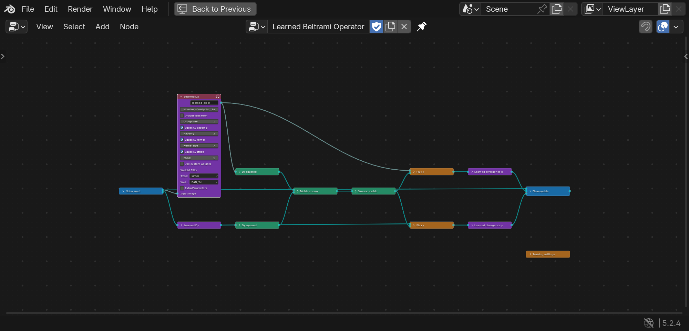
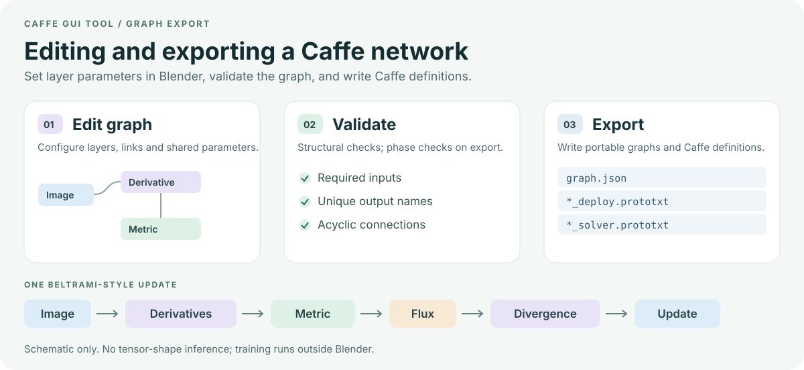
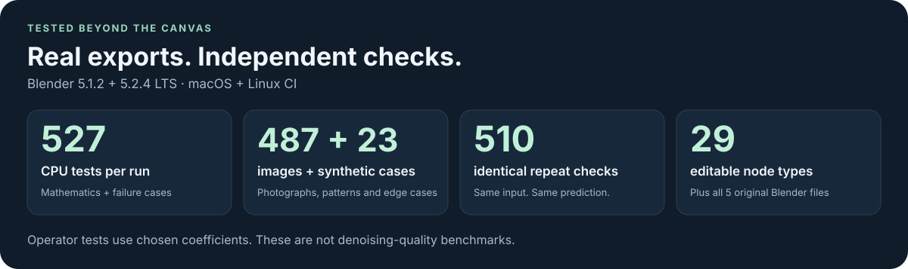

# Caffe GUI Tool

**See the network. Change the experiment. Keep the mathematics in view.**

A visual neural network editor inside Blender. Connect nodes, choose shared
weights, and export Caffe networks.



*The updated editor in Blender 5.2.4 LTS. Expand a node to edit its filters; follow the colored branches through the computation. This compact example is illustrative and untrained.*

## An old research tool, ready to explore again

Explore **Patch-Beltrami image denoising**: turn a geometric process into a
trainable network, then experiment with its filters, connections and stages.

Version **2.0.0** brings that workflow to modern Blender, using
[Blender Neural Composer](https://github.com/twerdster/blender-neural-composer)
and preserving the original research files.

| You want to… | The updated tool helps you… |
| --- | --- |
| Understand a network | Follow its branches and edit any of 29 node types |
| Try a different architecture | Reconnect stages and control shared weights |
| Keep an experiment | Save it in a `.blend` file or portable graph JSON |
| Export an experiment | Validate and export train/test, deployment and solver files |
| Revisit the research | Open five original `.blend` files and six recovered graphs |

## Try it in Blender

Build the add-on from this checkout; no extra Python packages are needed:

```sh
python3 tools/build_addon.py
```

1. In Blender, open **Edit → Preferences → Add-ons → Install from Disk…**
   and select `dist/caffe-gui-tool-2.0.0.zip`.
2. Enable **Caffe GUI Tool / Neural Operator Composer**. Disable an older
   Caffe Nodes or Neural Operator Composer installation first.
3. Open a Node Editor, choose **Neural Operator Composer**, and press **N**.
   In the **Composer** sidebar, load an example and try **Validate Graph**.

Start with the compact example, then explore a recovered research graph.
Expand nodes to edit parameters; use **Add → Neural Operators** to add your own.

[Installation, exporting, CPU inference and test commands →](docs/USAGE.md)

## From an image to a geometric update

The original idea connects image derivatives, a learned metric and a flow
update into a stage that can be repeated. The editor makes those branches and
shared parameters visible.



For the scientific story and the distinction between these experiments and
the final thesis models, read [what the original work tried to achieve](docs/report-analysis.md).

## What we checked

Tests exercise Blender, the installable ZIP, original research files, synthetic
inputs and this repository's public photographs.



**527 CPU tests per run**, using 487 photographs and 23 synthetic cases.
Across 510 repeat checks, the same input produced exactly the same prediction.

The complete harness passed on **Blender 5.1.2 and 5.2.4 LTS**, on both
**macOS Apple silicon and [Linux CI](https://github.com/twerdster/caffe-gui-tool/actions/runs/43260279151)**.
Exported standard-layer networks were compared with independent NumPy calculations.
[Read the measured results and limits →](docs/VALIDATION.md)

> **Research boundary:** the compact demo is untrained. These checks establish
> editor/export behavior and tested operator correctness; they do not establish
> training convergence or denoising quality. Historical custom `Padding` requires
> the [research Caffe fork](https://github.com/twerdster/caffe). Final trained
> models are in [Deep Patch-Beltrami](https://github.com/twerdster/deep-patch-beltrami).

## People and origins

Original node editor by [H. Tomkins](https://github.com/hctomkins/caffe-gui-tool),
extended by **Aaron Wetzler and Rom Hershkovitz**. The visual designer appears
in §4.5.2 and Figure 4.17 of Aaron Wetzler's *Topics in Computational Geometric
Vision*, PhD thesis, Technion — Israel Institute of Technology, August 2017.

Historical code, graphs and operator coefficients retain the [Unlicense](LICENSE).
Modern interface, tests, packaging and runtime tooling use [MIT](LICENSES/MIT.txt).
The test schema retains the [Caffe BSD license](LICENSES/Caffe-BSD.txt).
Existing dataset images retain their original terms and are excluded from the
add-on ZIP. See [NOTICE](NOTICE) for full attribution.
