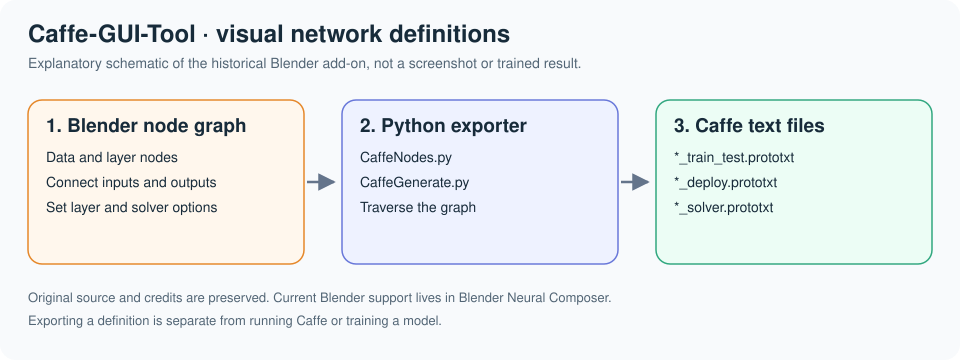

# Caffe-GUI-Tool

Caffe-GUI-Tool uses Blender's node editor to describe Caffe networks. Users connect data, layer,
loss and solver nodes; the Python exporter traverses that graph and writes network and solver
configuration files. This is a historical fork of [H. Tomkins' original project](https://github.com/hctomkins/caffe-gui-tool),
with research extensions by Aaron Wetzler and Rom Hershkovitz.

*Source-level schematic, not a screenshot or a trained-model result.*

## Implementation and outputs

[CaffeNodes.py](CaffeNodes.py) defines the node tree, sockets and editable parameters.
[CaffeGenerate.py](CaffeGenerate.py) implements the `nodes.make_solver` operator and text templates.
It writes these files to the solver node's configured output directory:

- `<name>_train_test.prototxt`: training and test network definition.
- `<name>_deploy.prototxt`: deployment network definition.
- `<name>_solver.prototxt`: optimization settings and network path.
- `train_<name>.sh`: a shell command for a separately installed Caffe executable.

The exporter formats configuration; it does not implement Caffe's numerical operators. Exporting
these files does not verify that Caffe accepts the graph, that the referenced data exists or that
training succeeds. Inspect the generated shell command and its executable/data paths before
invoking it. Research assets under `patch_beltrami/` are preserved separately from the editor.

## Loading the historical scripts

The implementation requires Blender's Python API, including `bpy` and `nodeitems_utils`. It is
not a standalone Python application. No exact working Blender version or reproducible installation
record is included, and current Blender compatibility has not been checked.

Both source files contain `register()` functions and `__main__` entry points for Blender's Text
Editor. The source-supported starting procedure is to open and run `CaffeNodes.py`, then
`CaffeGenerate.py` in a compatible Blender session. Inspect the registered Caffe node tree and
set the solver name, writable output directory, data paths and Caffe executable path before
invoking `nodes.make_solver`. This procedure is inferred from the source and was not executed for
this documentation revision. Output files with matching names are overwritten.

For a continuation intended for current Blender releases, see [Blender Neural Composer](https://github.com/twerdster/blender-neural-composer)
and its own installation and validation instructions.

## Validation and limitations

Review date: 2026-11-12.

This revision reviewed the node definitions, registration code, exporter and output filenames. It
did not launch Blender, export a graph, parse the output with Caffe or run numerical inference or
training. There is no automated test suite or saved validation record for this historical editor.

The templates cover only the Caffe parameters implemented in these scripts, not the complete
`caffe.proto` schema. Legacy Blender APIs and incomplete exporter branches require investigation
before using the tool for new work. The current continuation's test results do not apply to this
preserved implementation.

## Attribution and license

Existing source credits and [the Unlicense](LICENSE) are retained. Original implementation and
research files are unchanged by this documentation revision.
